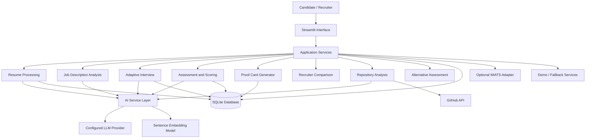

# ProofSkill AI — System Architecture

**Project:** ProofSkill AI  
**Problem ID:** IM-105 Advanced  
**Status:** Proposed Architecture  
**Primary Language:** Python  
**Initial Interface:** Streamlit  
**Initial Database:** SQLite

---

## 1. Architecture Overview

ProofSkill AI uses a modular architecture that separates the user interface, application logic, AI services, data storage, and external integrations.

The application should support two operating modes:

1. **Demo mode:** Uses sample data and deterministic fallback services to demonstrate the complete workflow without external credentials.
2. **Live mode:** Uses configured AI services and available integrations. Features requiring external access must handle failures gracefully.

The system must not require every external integration to be available before the core workflow can run.

## 2. High-Level Architecture



This diagram represents the proposed design. Components should be marked implemented only after they exist and have been tested.

## 3. Application Layers

### 3.1 Presentation Layer

**Technology:** Streamlit

Responsibilities:

- Candidate workflow and resume upload.
- Job description input.
- Interview question display and answer submission.
- Candidate review of GitHub links extracted from the resume.
- Candidate consent, repository selection, and selected-project task flow.
- Assessment results and Proof Card display.
- Alternative assessment flow.
- Recruiter dashboard and candidate comparison.
- Clear loading, error, and fallback messages.

The presentation layer should not contain complex scoring logic or direct database queries. Those responsibilities belong in service and repository modules.

### 3.2 Application Service Layer

Responsibilities:

- Coordinate the candidate assessment workflow.
- Validate inputs.
- Call resume, interview, scoring, and repository services.
- Enforce consent and access rules.
- Store assessment results.
- Generate Proof Cards.
- Prepare comparable candidate results for recruiters.

Services should expose small, testable functions rather than depending directly on Streamlit session state.

### 3.3 AI Service Layer

Responsibilities:

- Generate interview questions.
- Evaluate answers against defined rubrics.
- Extract structured skills and supporting evidence.
- Produce semantic similarity scores.
- Explain assessment results.
- Provide predictable fallbacks when an AI provider is unavailable.

All AI provider calls should pass through a common interface. This makes it possible to change providers without rewriting the entire application.

**Important:** AI-generated statements must not be treated as verified facts unless they are supported by available evidence.

### 3.4 Data Access Layer

Responsibilities:

- Create and retrieve candidate records.
- Store resumes or extracted resume text according to the configured storage policy.
- Store job descriptions, questions, answers, scores, and evidence references.
- Store consent records and repository analysis metadata.
- Retrieve assessment results for Proof Cards and recruiter comparisons.

Database access should be centralized in repository modules rather than scattered throughout the UI.

### 3.5 Integration Layer

Potential integrations include:

- Configured LLM provider.
- Sentence Transformers embedding model.
- GitHub REST API.
- Speech-to-text service.
- IMATS sandbox API, if its documentation and credentials are available.

Each external integration should have:

- Configuration validation.
- Timeouts and error handling.
- Clear failure messages.
- A mock or fallback implementation where practical.
- Tests that do not require real API credentials.

---

## 4. Proposed Project Structure

```text
Proof-Skill-AI/
├── app.py
├── requirements.txt
├── .env.example
├── .gitignore
├── README.md
├── PROJECT_CONTEXT.md
├── TASKS.md
├── docs/
│   ├── PRD.md
│   ├── ROADMAP.md
│   └── ARCHITECTURE.md
├── src/
│   └── proofskill/
│       ├── __init__.py
│       ├── config.py
│       ├── database.py
│       ├── schemas.py
│       ├── services/
│       │   ├── __init__.py
│       │   ├── resume_service.py
│       │   ├── job_service.py
│       │   ├── interview_service.py
│       │   ├── evaluation_service.py
│       │   ├── proof_card_service.py
│       │   ├── repository_service.py
│       │   ├── alternative_assessment_service.py
│       │   └── recruiter_service.py
│       ├── ai/
│       │   ├── __init__.py
│       │   ├── provider.py
│       │   ├── prompts.py
│       │   ├── embeddings.py
│       │   └── fallback.py
│       ├── integrations/
│       │   ├── __init__.py
│       │   ├── github_client.py
│       │   └── imats_client.py
│       └── repositories/
│           ├── __init__.py
│           ├── candidate_repository.py
│           ├── assessment_repository.py
│           └── job_repository.py
├── data/
│   └── demo/
├── tests/
│   ├── test_resume_service.py
│   ├── test_interview_service.py
│   ├── test_evaluation_service.py
│   ├── test_proof_card_service.py
│   └── test_recruiter_service.py
└── artifacts/
```

This is the target structure, not a claim that every file has already been created. Keep the initial implementation smaller if needed, but preserve clear separation between UI, services, integrations, and storage.

## 5. Core Data Flow

### 5.1 Candidate Assessment

1. Candidate uploads a resume or enters relevant information manually.
2. The resume service extracts readable text.
3. The job service parses job requirements into structured skills.
4. The assessment service matches available candidate evidence to job requirements.
5. The interview service generates relevant questions.
6. The candidate submits answers.
7. The evaluation service scores answers using a defined rubric.
8. Results and evidence references are stored.
9. The Proof Card service creates a structured summary.

### 5.2 Repository Assessment

1. Resume extraction identifies GitHub profile or repository URLs as candidate-provided claims and displays them for review.
2. No network request is made based only on a resume link.
3. If the candidate consents to repository discovery, the GitHub client validates the link and retrieves bounded public repository metadata.
4. The UI presents discovered repositories. The candidate chooses and confirms which repositories, if any, to assess.
5. The repository service retrieves and inspects a bounded set of relevant files only from selected repositories.
6. The project assessment service generates evidence-grounded questions and bounded tasks about explaining code, proposing or submitting a focused patch, approaches, alternatives, architecture, debugging, and testing.
7. The candidate submits explanations or code changes as assessment responses; the service evaluates them against a consistent rubric and inspected evidence.
8. Findings, selection/consent provenance, and limitations are attached to the assessment.

A repository being public does not automatically prove that the candidate authored every file. Avoid definitive authorship or plagiarism claims based on metadata alone.
The integration never writes to the candidate's GitHub repository or executes repository code. Candidates who decline discovery or lack accessible evidence receive an equivalent non-repository assessment.

### 5.3 Recruiter Comparison

1. The recruiter selects a job description.
2. The recruiter selects candidates who have completed an assessment.
3. The recruiter service applies the same scoring rubric and job requirements to each candidate.
4. The dashboard displays comparable results and evidence.
5. The recruiter can inspect supporting information before making a decision.

The ranking service must not use college name, gender, age, or location as scoring features.

---

## 6. Proposed Data Model

The initial SQLite database may contain the following logical entities.

| Entity | Purpose |
|---|---|
| `candidates` | Candidate identifier and minimal required profile information |
| `resumes` | Resume metadata and extracted text, subject to retention policy |
| `jobs` | Job description and structured requirements |
| `assessments` | Assessment status, configuration, and timestamps |
| `questions` | Interview questions, types, and related skills |
| `answers` | Candidate responses and references to their assessment |
| `evaluations` | Rubric scores, explanations, and uncertainty information |
| `evidence` | Source references supporting skill-related claims |
| `repository_selections` | Candidate-confirmed repositories selected for assessment |
| `repository_analyses` | Selected-repository metadata, bounded findings, and limitations |
| `proof_cards` | Structured candidate assessment summaries |
| `consent_records` | Consent scope, timestamp, and revocation status |

Use stable identifiers and foreign keys to connect related records. Define required fields, constraints, and indexes during database implementation.

Do not collect demographic information unless there is a documented, authorized need for a separate fairness evaluation. Such data must never enter the candidate ranking feature set.

---

## 7. Scoring Architecture

The system should keep these concepts separate:

- **Skill performance:** Evidence of how well a candidate demonstrates a particular skill.
- **Evidence coverage:** How much of the job's required skill set has been assessed.
- **Evidence confidence:** How reliable and direct the available supporting evidence is.
- **Communication assessment:** Relevant clarity of the candidate's explanation, evaluated using an explicit rubric.
- **Overall assessment:** A transparent combination of the defined scoring dimensions.
- **Recruiter ranking:** Comparison against the requirements of a specific job description.

Do not merge these concepts into one unexplained score.

For every score, record the rubric version, input evidence references, and explanation where practical. Missing evidence should be labeled as **not assessed** rather than automatically treated as poor performance.

AI-generated evaluations should be validated with test cases and reviewed for consistency. A score must not be described as an objective measure of a candidate's total ability.

---

## 8. AI Provider and Fallback Design

Define a common provider interface for operations such as:

- `generate_questions(...)`
- `evaluate_answer(...)`
- `extract_skills(...)`
- `explain_assessment(...)`

The exact function signatures should be finalized when the provider module is implemented.

### Live mode

- Uses configured AI providers.
- Validates structured outputs.
- Handles timeouts and malformed responses.
- Records the provider and model configuration needed for reproducibility, without storing secrets.

### Demo mode

- Uses deterministic sample inputs and outputs.
- Demonstrates the end-to-end workflow without API credentials.
- Clearly labels simulated results.
- Does not pretend that fallback output came from a live model.

A fallback should be useful and predictable, not silently substitute fabricated evidence for real assessment results.

---

## 9. Security and Privacy

- Keep API keys in environment variables.
- Commit `.env.example`, never a real `.env` containing secrets.
- Validate file types and limit upload sizes.
- Avoid executing uploaded files or repository code.
- Treat resume text, repository files, and model output as untrusted input.
- Protect against prompt injection in uploaded content.
- Never fetch a resume-extracted link until the candidate consents to discovery.
- Restrict repository file access to candidate-selected, explicitly confirmed repositories.
- Keep GitHub access read-only; never push or commit assessment changes.
- Bound repository, file, response-size, and time limits and avoid exposing secrets found in files.
- Never request GitHub credentials merely to inspect a public repository.
- Minimize retained personal information.
- Provide a documented retention and deletion approach.
- Avoid logging raw resumes, complete answers, access tokens, or unnecessary personal data.
- Treat external model providers as potential data processors and disclose relevant data sharing.

---

## 10. Testing Strategy

### Unit tests

Test each service independently, including:

- Resume text extraction.
- Job requirement parsing.
- Skill-to-evidence mapping.
- Question generation fallback.
- Answer scoring and rubric validation.
- Proof Card generation.
- Candidate comparison.
- Consent enforcement.

### Integration tests

Test the workflow from resume input through Proof Card generation using a temporary database and mock AI provider.

### Fairness and robustness tests

Verify that:

- Changing an excluded demographic field does not change a ranking.
- Missing information is not automatically treated as negative evidence.
- Invalid or malformed model output is handled safely.
- Repository access is not attempted without consent.
- Repository file retrieval is limited to candidate-selected repositories.
- Project tasks reference inspected evidence and do not execute or remotely modify code.
- The no-repository assessment path works.
- External API failures do not crash demo mode.

### Evaluation tests

When the official dataset becomes available, document the split, metrics, baseline, and limitations. Do not report official benchmark results from synthetic demo data.

---

## 11. External Dependencies

| Dependency | Purpose | Fallback |
|---|---|---|
| LLM provider | Interview questions and structured evaluations | Deterministic demo provider |
| Sentence Transformers | Semantic skill and evidence matching | Keyword-based baseline |
| GitHub API | Public repository metadata and file access | Manual project description |
| Speech-to-text | Spoken interview answers | Typed answers |
| IMATS sandbox API | Required competition integration, if confirmed | Mock adapter for local demo |
| Official assessment dataset | Validation and benchmarking | Clearly labeled synthetic tests |

The availability, usage limits, licensing, and integration requirements of each dependency must be confirmed before relying on it for the final demonstration.

---

## 12. Architecture Decision Rules

- Prefer simple, testable Python modules over unnecessary abstractions.
- Keep the application runnable after every milestone.
- Avoid making the entire application dependent on a single AI provider.
- Do not add model complexity before establishing a reliable baseline.
- Keep all scoring logic in testable service functions.
- Store assessment outputs with enough context to explain how they were produced.
- Document architectural changes when implementation needs differ from this proposal.

**Current implementation status:** Proposed. Update this document as architecture decisions are implemented and verified.
