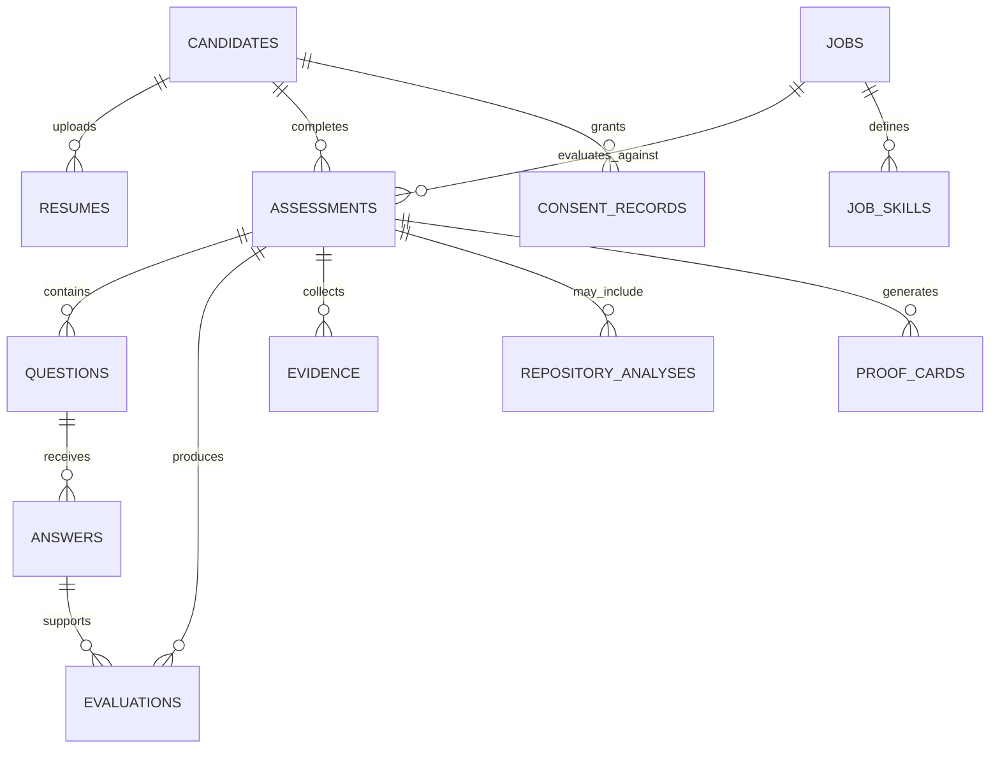

# ProofSkill AI — Data Model

**Version:** 1.0  
**Status:** Proposed  
**Database:** SQLite for the MVP  
**Primary identifier:** UUID or another unique, non-guessable identifier

---

## 1. Purpose

This document defines how ProofSkill AI stores candidates, job descriptions, assessments, evidence, evaluation results, consent, and Proof Cards.

The data model must support:

- Candidate assessment history.
- Job-specific skill evaluation.
- Evidence-backed scores.
- Adaptive interviews.
- Optional repository analysis.
- Alternative assessments.
- Explainable recruiter comparisons.
- Privacy, consent, and data retention.

This document describes the intended schema. Tables should be marked implemented only after the corresponding migrations and tests exist.

## 2. Data Model Principles

1. Use stable identifiers rather than candidate names as primary keys.
2. Connect assessments, questions, answers, evaluations, and evidence through foreign keys.
3. Store assessment and rubric versions for reproducibility.
4. Distinguish missing information from a score of zero.
5. Keep evidence confidence separate from skill performance.
6. Do not use college name, gender, age, or location as ranking features.
7. Collect only information needed for the assessment.
8. Obtain consent before optional repository analysis.
9. Never store API secrets in the database.
10. Avoid storing unnecessary raw resumes or personal data indefinitely.

## 3. Entity Relationships

The diagram is conceptual. The exact foreign keys and constraints are defined below.

## 4. Table Definitions

### 4.1 `candidates`

Stores a minimal candidate record.

| Column | Type | Constraints | Purpose |
|---|---|---|---|
| `id` | TEXT | Primary key | Unique candidate identifier |
| `display_name` | TEXT | Nullable | Optional display name |
| `created_at` | TEXT | Required | Creation timestamp in UTC |
| `updated_at` | TEXT | Required | Last update timestamp |

Avoid storing demographic attributes or unnecessary contact information in the MVP.

### 4.2 `resumes`

Stores resume metadata and extracted text according to the configured retention policy.

| Column | Type | Constraints | Purpose |
|---|---|---|---|
| `id` | TEXT | Primary key | Unique resume identifier |
| `candidate_id` | TEXT | Foreign key | Owner of the resume |
| `filename` | TEXT | Required | Original or sanitized filename |
| `content_type` | TEXT | Required | Detected document type |
| `extracted_text` | TEXT | Nullable | Extracted text, subject to retention |
| `content_hash` | TEXT | Nullable | Optional integrity or deduplication hash |
| `created_at` | TEXT | Required | Upload timestamp |

Do not treat the filename or extracted text as trusted instructions. Validate file types and size before processing.

### 4.3 `jobs`

Stores job descriptions and their structured requirements.

| Column | Type | Constraints | Purpose |
|---|---|---|---|
| `id` | TEXT | Primary key | Unique job identifier |
| `title` | TEXT | Required | Job title |
| `description` | TEXT | Required | Job description |
| `requirements_json` | TEXT | Required | Structured skill requirements |
| `created_at` | TEXT | Required | Creation timestamp |

`requirements_json` should contain validated data rather than arbitrary model output.

### 4.4 `job_skills`

Stores individual skills required for a job.

| Column | Type | Constraints | Purpose |
|---|---|---|---|
| `id` | TEXT | Primary key | Unique requirement identifier |
| `job_id` | TEXT | Foreign key | Related job |
| `skill_name` | TEXT | Required | Normalized skill name |
| `weight` | REAL | Required | Relative importance |
| `required` | INTEGER | Required | Whether the skill is required |
| `created_at` | TEXT | Required | Creation timestamp |

**Validation rules:**

- Weights must be non-negative.
- Total weights for a job must be greater than zero.
- Normalize weights to 100% when calculating the final score.
- Required skills that have not been assessed must be flagged.

### 4.5 `assessments`

Represents one candidate's assessment for one job.

| Column | Type | Constraints | Purpose |
|---|---|---|---|
| `id` | TEXT | Primary key | Unique assessment identifier |
| `candidate_id` | TEXT | Foreign key | Candidate being assessed |
| `job_id` | TEXT | Foreign key | Target job |
| `status` | TEXT | Required | Current workflow status |
| `mode` | TEXT | Required | `demo` or `live` |
| `rubric_version` | TEXT | Required | Scoring rubric version |
| `started_at` | TEXT | Nullable | Start timestamp |
| `completed_at` | TEXT | Nullable | Completion timestamp |
| `created_at` | TEXT | Required | Record creation timestamp |

Suggested statuses:

- `draft`
- `in_progress`
- `completed`
- `incomplete`
- `cancelled`

Only assessments meeting the completion and evidence requirements should be considered complete.

### 4.6 `questions`

Stores interview questions generated or selected for an assessment.

| Column | Type | Constraints | Purpose |
|---|---|---|---|
| `id` | TEXT | Primary key | Unique question identifier |
| `assessment_id` | TEXT | Foreign key | Parent assessment |
| `skill_name` | TEXT | Required | Skill being evaluated |
| `question_text` | TEXT | Required | Question content |
| `question_type` | TEXT | Required | Technical, conceptual, project, or other supported type |
| `difficulty` | TEXT | Nullable | Configured difficulty level |
| `weight` | REAL | Required | Question importance |
| `sequence_number` | INTEGER | Required | Position in the interview |
| `created_at` | TEXT | Required | Creation timestamp |

Generated questions must be validated before being stored or displayed.

### 4.7 `answers`

Stores candidate responses.

| Column | Type | Constraints | Purpose |
|---|---|---|---|
| `id` | TEXT | Primary key | Unique answer identifier |
| `question_id` | TEXT | Foreign key | Question being answered |
| `answer_text` | TEXT | Nullable | Text response or transcript |
| `input_mode` | TEXT | Required | `typed`, `voice_transcript`, or another supported mode |
| `status` | TEXT | Required | Assessment status for the response |
| `submitted_at` | TEXT | Nullable | Submission timestamp |

Do not store raw audio by default. If audio storage is introduced, define explicit consent, access, encryption, and deletion rules.

### 4.8 `evaluations`

Stores scores and explanations produced by the evaluation service.

| Column | Type | Constraints | Purpose |
|---|---|---|---|
| `id` | TEXT | Primary key | Unique evaluation identifier |
| `assessment_id` | TEXT | Foreign key | Related assessment |
| `answer_id` | TEXT | Nullable foreign key | Answer being evaluated |
| `skill_name` | TEXT | Required | Skill evaluated |
| `rubric_score` | REAL | Nullable | Raw answer score from 0 to 4 |
| `rubric_max_score` | REAL | Nullable | Raw rubric maximum; 4 for this project's answer rubric |
| `performance_score` | REAL | Nullable | Normalized answer or skill performance score from 0 to 100 |
| `evidence_confidence` | TEXT | Required | `low`, `medium`, `high`, or `not_assessed` |
| `status` | TEXT | Required | `assessed` or `not_assessed` |
| `explanation` | TEXT | Nullable | Reason for the result |
| `rubric_version` | TEXT | Required | Rubric used |
| `model_identifier` | TEXT | Nullable | Model identifier, if applicable |
| `created_at` | TEXT | Required | Evaluation timestamp |

A missing or invalid evaluation must not be converted automatically to a zero.

For an evaluated answer, retain its raw rubric score and maximum alongside any normalized performance score. Leave raw scores null when the response is not assessed; do not convert missing evidence into zero.

Store model and prompt version metadata where practical, without storing secrets.

### 4.9 `evidence`

Stores references to material supporting assessment claims.

| Column | Type | Constraints | Purpose |
|---|---|---|---|
| `id` | TEXT | Primary key | Unique evidence identifier |
| `assessment_id` | TEXT | Foreign key | Related assessment |
| `skill_name` | TEXT | Required | Skill supported by the evidence |
| `source_type` | TEXT | Required | Resume, answer, repository, exercise, or other source |
| `source_id` | TEXT | Nullable | Reference to the source record |
| `excerpt` | TEXT | Nullable | Minimal relevant excerpt |
| `relevance` | REAL | Nullable | Optional relevance score |
| `created_at` | TEXT | Required | Record creation timestamp |

Evidence relevance is not equivalent to proof of competence or authorship. Preserve the distinction between source material and the conclusions drawn from it.

### 4.10 `repository_analyses`

Stores metadata for optional repository assessments.

| Column | Type | Constraints | Purpose |
|---|---|---|---|
| `id` | TEXT | Primary key | Unique analysis identifier |
| `assessment_id` | TEXT | Foreign key | Related assessment |
| `repository_url` | TEXT | Required | Validated URL of one candidate-selected repository; one record per selected repository |
| `consent_record_id` | TEXT | Foreign key | Applicable consent record |
| `selection_record_id` | TEXT | Foreign key | Candidate's explicit repository selection and confirmation |
| `status` | TEXT | Required | Pending, completed, failed, or cancelled |
| `findings_json` | TEXT | Nullable | Bounded structured findings with file paths and evidence references |
| `limitations` | TEXT | Nullable | Access or analysis limitations |
| `created_at` | TEXT | Required | Analysis timestamp |

Create one analysis record per candidate-selected repository. Preserve the discovery consent and selection confirmation separately so a resume link alone cannot authorize network access or file retrieval. Do not store access tokens in this table. Validate URLs and restrict outbound requests to supported GitHub URLs to reduce server-side request forgery risks.

### 4.11 `repository_selections`

Records each candidate's explicit selection of repositories offered for assessment.

| Column | Type | Constraints | Purpose |
|---|---|---|---|
| `id` | TEXT | Primary key | Unique selection record |
| `assessment_id` | TEXT | Foreign key | Related assessment |
| `consent_record_id` | TEXT | Foreign key | Consent covering repository discovery/analysis |
| `repository_url` | TEXT | Required | Validated repository URL selected by the candidate |
| `selected_at` | TEXT | Required | Confirmation timestamp |

Store one row per selected repository. Do not treat an extracted resume URL or discovery consent as repository selection. Do not store tokens or source contents in this table.

### 4.12 `consent_records`

Records consent for optional data processing.

| Column | Type | Constraints | Purpose |
|---|---|---|---|
| `id` | TEXT | Primary key | Unique consent record |
| `candidate_id` | TEXT | Foreign key | Candidate granting consent |
| `scope` | TEXT | Required | Purpose and scope of consent |
| `status` | TEXT | Required | Granted, revoked, or another defined state |
| `granted_at` | TEXT | Nullable | Consent timestamp |
| `revoked_at` | TEXT | Nullable | Revocation timestamp |
| `created_at` | TEXT | Required | Record creation timestamp |

Consent must be specific enough to identify what the candidate authorized. Revocation should prevent future processing within the relevant scope, subject to applicable retention and legal requirements.

### 4.13 `proof_cards`

Stores a generated Proof Card and its version.

| Column | Type | Constraints | Purpose |
|---|---|---|---|
| `id` | TEXT | Primary key | Unique Proof Card identifier |
| `assessment_id` | TEXT | Foreign key | Source assessment |
| `version` | INTEGER | Required | Proof Card version |
| `performance_score` | REAL | Nullable | Overall or provisional score |
| `evidence_coverage` | REAL | Nullable | Percentage of required skills assessed |
| `summary_json` | TEXT | Required | Structured summary and evidence references |
| `created_at` | TEXT | Required | Generation timestamp |

Use a unique constraint on `(assessment_id, version)`.

Proof Cards must distinguish provisional scores from fully assessed scores. Do not include unsupported claims or unnecessary personal data.

---

## 5. Database Constraints and Indexes

The implementation should:

- Enable SQLite foreign key enforcement.
- Use transactions for related writes.
- Add indexes to frequently queried foreign keys.
- Validate score ranges from 0 to 100.
- Validate confidence and status values against supported enumerations.
- Enforce unique question sequence numbers within an assessment.
- Enforce unique Proof Card versions within an assessment.
- Store timestamps in a consistent UTC format.
- Use parameterized SQL queries.
- Avoid destructive schema changes without a migration or documented reset.

Recommended indexes include:

- `resumes(candidate_id)`
- `assessments(candidate_id, job_id)`
- `questions(assessment_id, sequence_number)`
- `answers(question_id)`
- `evaluations(assessment_id, skill_name)`
- `evidence(assessment_id, skill_name)`
- `repository_selections(assessment_id)`
- `repository_analyses(assessment_id)`

## 6. Data Retention and Deletion

The implementation must define a retention policy before using real candidate information.

Minimum expectations:

- Prefer demo data during development and presentations.
- Store only the resume information needed for assessment.
- Avoid unnecessary copies of uploaded documents.
- Support deletion or anonymization of candidate data where appropriate.
- Define how deletion affects related assessments, evidence, and Proof Cards.
- Preserve only records required for legitimate operational or legal purposes.
- Avoid putting candidate data in application logs.
- Do not use candidate submissions for model training without appropriate authorization.

A deletion operation must consider dependent records and the configured retention policy. Do not promise complete erasure until all relevant storage locations and backups are addressed.

## 7. Demo Data

Demo records must be clearly identifiable as synthetic.

Suggested identifiers:

- `demo-candidate-001`
- `demo-job-python-001`
- `demo-assessment-001`

Use synthetic names, resumes, answers, and repository examples. Do not populate the demo database with real candidate information.

Demo results must not be presented as official dataset results.

## 8. Migration Strategy

For the MVP:

1. Create a database initialization module.
2. Define schema creation in one controlled location.
3. Enable foreign keys on each SQLite connection.
4. Add a schema version table when migrations are introduced.
5. Test initialization against a fresh temporary database.
6. Preserve or migrate existing data when the schema changes.
7. Document any destructive reset as a development-only operation.

Avoid creating tables independently in multiple UI modules.

## 9. Data Model Acceptance Criteria

- [ ] All implemented tables have a defined schema.
- [ ] Primary keys and foreign keys are enforced.
- [ ] Database initialization works from a clean state.
- [ ] Invalid scores and statuses are rejected.
- [ ] Candidate assessments are linked to the correct job.
- [ ] Answers are linked to their questions.
- [ ] Evaluations preserve their rubric version.
- [ ] Evidence can be traced to its source.
- [ ] Repository analysis references a valid consent record.
- [ ] Proof Card versions are identifiable.
- [ ] Demo data is synthetic and clearly labeled.
- [ ] Retention and deletion behavior is documented.
- [ ] Database tests pass.

## 10. Implementation Status

**Current status:** Proposed schema.

The actual schema may be refined during implementation, but changes must remain consistent with `PROJECT_CONTEXT.md`, `docs/PRD.md`, `docs/ARCHITECTURE.md`, and `docs/SCORING.md`.
